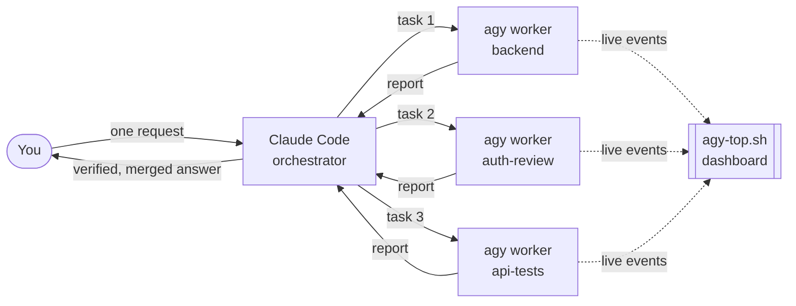

<div align="center">



<p>
  <a href="https://github.com/MaheshThakur9152/agy-subagent/actions/workflows/test.yml"></a>
  <a href="CHANGELOG.md"></a>
  <a href="LICENSE"></a>
  
  
  
</p>

**Ask Claude Code for a job. It splits the job across [Google Antigravity CLI](https://antigravity.google) (`agy`) workers, runs them in parallel, checks their work, and gives you one answer.**

[Quick start](#-quick-start) · [Videos](#-videos) · [Usage](#-usage) · [Live dashboard](#-live-dashboard) · [Update](#-updating) · [Reference](#-reference) · [Troubleshooting](#-troubleshooting)

</div>

---

## 🎬 Videos

### Installation

<!--
  To add the installation video:
  1. Open this README on github.com and click the pencil (Edit) icon.
  2. Delete the <a>...</a> line below.
  3. Drag your .mp4 or .mov file (max 100 MB) into the editor at that spot.
     GitHub uploads it and inserts a link like https://github.com/user-attachments/assets/<id>
  4. Keep that link on its own line, with a blank line above and below. GitHub then shows a video player.
-->
<a href="#-quick-start"></a>

### Demo

<!--
  To add the demo video: same steps as above, replacing the <a>...</a> line below.
-->
<a href="#-live-dashboard"></a>

---

## ⚡ Quick start

You need three things: `agy`, bash, and Claude Code (or Codex).

**1. Install `agy` and log in once.** Get it from [antigravity.google](https://antigravity.google), then run:

```bash
agy --version     # tested with 1.5.9
agy               # log in interactively one time, then exit
```

**2. Install the plugin in Claude Code.**

```bash
claude plugin marketplace add MaheshThakur9152/agy-subagent
claude plugin install agy@agy-subagent
```

Or type the same commands inside a Claude Code session: `/plugin marketplace add MaheshThakur9152/agy-subagent`, then `/plugin install agy@agy-subagent`. Restart Claude Code afterwards.

**3. Ask for work.**

```text
/agy:agy find out why the /search endpoint is slow
```

or in plain words:

```text
Use three agy workers to audit authentication, authorization and file uploads.
```

**4. Watch the workers** in a second terminal (optional):

```bash
bash ~/.claude/plugins/cache/agy-subagent/agy/*/skills/agy/scripts/agy-top.sh
```

Claude tells you the exact path when it starts workers.

<details>
<summary><b>Requirements by OS</b></summary>

| OS | What you need |
|---|---|
| Linux | bash 4.4+ and coreutils `timeout` (installed by default on most distros) |
| macOS | a newer bash and coreutils: `brew install bash coreutils` |
| Windows | Git Bash (bundled with [Git for Windows](https://git-scm.com/download/win)). The test suite passes there |

Optional: the caveman plugin inside agy makes worker reports short. Check with `agy plugin list`.

</details>

<details>
<summary><b>Other hosts: Codex CLI, Gemini CLI, Cursor, GitHub Copilot, opencode</b></summary>

**Codex CLI.** Codex 0.166 reads this repo's `.claude-plugin` manifests natively:

```bash
codex plugin marketplace add MaheshThakur9152/agy-subagent
codex plugin add agy@agy-subagent
```

**Gemini CLI, Cursor, GitHub Copilot, opencode.** These hosts read SKILL.md skills from `~/.agents/skills/` and have no plugin install. Symlink the skill:

```bash
git clone https://github.com/MaheshThakur9152/agy-subagent.git ~/src/agy-subagent
mkdir -p ~/.agents/skills && ln -s ~/src/agy-subagent/skills/agy ~/.agents/skills/agy
```

To update, run `git -C ~/src/agy-subagent pull`.

Only Claude Code is tested end to end. Codex plugin install and skill listing were verified; a full Codex-driven run was not. The other hosts are documented as reading `~/.agents/skills/` but have not been tested with this skill.

**Local development:** `claude --plugin-dir /path/to/agy-subagent`.

</details>

---

## 🧭 How it works



1. **Claude plans.** It writes a self-contained task per worker, picks a model that fits each role, and keeps one task for itself. The prompt contract, roles and models are in [`worker-prompts.md`](skills/agy/references/worker-prompts.md).
2. **Workers run while Claude works.** Each worker is one `agy` process started by [`agy-run.sh`](skills/agy/scripts/agy-run.sh). The runner sets the permission mode and a timeout, removes secrets from the environment, and passes the prompt on stdin. Claude does its own part in the meantime instead of waiting.
3. **Claude integrates as each worker finishes.** Every report ends with a git footer measured by the runner, so a claimed change that never happened is caught. Claude checks claims against the code, merges that worker's branch and runs the tests while the others keep going.
4. **Follow-ups keep context.** Claude resumes a finished worker's conversation instead of starting a new one. A worker that needs a decision stops with `BLOCKED: <question>`, and Claude answers and resumes it.
5. **You get one report.**

---

## 🛠 Usage

### From Claude Code

| You say | What happens |
|---|---|
| `/agy:agy investigate why the image pipeline takes 115 seconds` | one worker investigates and reports |
| "Use two agy workers to find the root cause of the slow `/search` API: one on the handler code, one on the SQL queries." | two read-only workers in parallel, results compared |
| "Use three agy workers to audit authentication, authorization and file uploads." | three reviewers, one consolidated audit |
| "Use agy workers to implement the cache module and the API tests in separate worktrees, then integrate." | each worker gets its own git worktree and branch; Claude merges and runs the tests |

### From a terminal (no Claude needed)

```bash
R=skills/agy/scripts/agy-run.sh

$R --perm unattended --name verbose-flag -- "add a --verbose flag to cli.py"
$R --perm sandbox --timeout 20m --model gemini-3.8-flash-high -- "review src/auth for injection bugs; read-only"
$R --perm unattended --cd ../app-agy-cache --add-dir ../shared -- "implement caching in api/client.py"
printf '%s' "$(cat long-task.md)" | $R --perm unattended --          # long tasks via stdin
$R --help
```

Follow up on a finished worker with its full context. Every run prints `agy-run: conversation=<id>` on stderr:

```bash
$R --perm sandbox --name auth-review-2 --conversation <id> -- "also check src/auth/reset.py"
```

Limit how many workers run at once, to save RAM. Extra runs wait for a free slot and show as QUEUED:

```bash
export AGY_RUN_MAX_JOBS=3
```

Parallel, one report file per worker:

```bash
mkdir -p .agy-runs
for area in backend frontend db; do
  $R --perm sandbox --name "$area" -- "Performance Engineer: investigate $area bottlenecks in this repo. Read-only." \
    >".agy-runs/$area.md" 2>".agy-runs/$area.err" &
done
wait
```

---

## 📺 Live dashboard

In Claude Code a running worker shows up only as a background shell command. The **AGY Control Center** (`agy-top.sh`) shows what each worker is doing right now:

- **Header:** repo and branch, running / queued / done / blocked / failed counts, slots in use out of `AGY_RUN_MAX_JOBS`, how long the dashboard has been open.
- **Workers:** one line each with ID, name, role or model, status, elapsed time, and what it is doing now (current tool, the text being written, or the first line of the report).
- **Detail** of the selected worker: task, directory, permission mode, model, tools used, tokens, recent steps, the report or the BLOCKED question or the error lines, and the conversation ID.
- **Events:** status changes and tool steps from all workers, newest first, with times.

There are no progress percentages: agy does not report how far along a task is.

<div align="center">

</div>

**Open it automatically in a split pane** (opt-in):

```bash
export AGY_RUN_UI=1     # then start workers as usual
```

Inside **Windows Terminal** the first worker opens a side pane titled "AGY Control Center", running Git Bash, and gives focus back to your Claude Code pane. Inside **tmux** it opens a split without taking focus. Only one dashboard opens, even when several workers start at once. If neither is available, the runner prints the command to run yourself and the worker starts as usual. The launcher is [`agy-ui.sh`](skills/agy/scripts/agy-ui.sh); `agy-ui.sh --dry-run` shows the command it would run.

**Or open it by hand** in any terminal:

```bash
skills/agy/scripts/agy-top.sh            # live view
skills/agy/scripts/agy-top.sh --here     # only the repo you are in (and worktrees beside it)
skills/agy/scripts/agy-top.sh --in ~/app # only that repo
skills/agy/scripts/agy-top.sh --once     # print one frame and exit
skills/agy/scripts/agy-top.sh --all      # include finished runs older than 12 hours
skills/agy/scripts/agy-top.sh --no-bell  # no terminal bell when a worker finishes
```

| Key | Action |
|---|---|
| `↑` `↓` or `k` `j` | select a worker |
| `enter` | inspect: open its full report (or error output) in `$PAGER` (default `less -R`) |
| `x` | stop the selected worker (asks `y/n`) |
| `r` | resume a finished worker: type a follow-up, sent in the same conversation with the same mode, directory and model. It shows up as `<name>+` |
| `?` | show the keys |
| `q` | detach: close the dashboard. Workers keep running |

States: RUNNING, QUEUED, STOPPING (stop requested from the dashboard), DONE, BLOCKED (the worker needs a decision), TIMEOUT, STOPPED, FAILED, LOST (the runner died without a result).

The dashboard reads only the event records added since its last look, cuts each record to 1500 bytes and collapses streamed text before bash sees it, and repaints only the lines that changed. Opening it never changes how workers run.

Each run writes `meta`, `events.ndjson` (agy's `stream-json` events), `report`, `err`, `rc` and `conversation` to `$AGY_RUN_DIR/<id>/`. The default is `~/.local/state/agy-runs`, with mode 700, and runs are deleted after 3 days. The runner still prints the plain text report on stdout. `AGY_RUN_LOG=0` turns the log off; agy then replaces the runner process, as in 0.2.0.

---

## 🔄 Updating

**Claude Code:**

```bash
claude plugin marketplace update agy-subagent
claude plugin update agy@agy-subagent
```

Then restart Claude Code. In a session, `/plugin` opens the same options in a menu, where you can also turn on auto-update for this marketplace.

The runner checks once a day whether a newer version is on GitHub, and prints `agy-run: agy-subagent X is available` on stderr if so. The check runs in the background and never delays a worker. `AGY_RUN_UPDATE_CHECK=0` turns it off.

**Codex:** `codex plugin marketplace upgrade agy-subagent`, then `codex plugin add agy@agy-subagent`. **Symlink installs:** `git pull` in the clone.

See [CHANGELOG.md](CHANGELOG.md) for what changed.

---

## 📖 Reference

<details>
<summary><b>Runner interface, options and environment</b></summary>

```
agy-run.sh [runner options] "task"
agy-run.sh [runner options] [agy flags...] -- "task"
echo "task" | agy-run.sh [runner options] [agy flags...] [--]
```

| Runner option | Meaning |
|---|---|
| `--perm sandbox\|unattended\|normal` | permission mode (below). Default `sandbox` |
| `--timeout DUR` | Go duration (`90s`, `20m`, `1h30m`), `0` = none. Default `30m` |
| `--cd DIR` | worker's working directory (agy's workspace root) |
| `--name NAME` | label shown in `agy-top.sh` (default: first line of the task) |
| `--no-caveman` | do not prefix `/caveman:ultracave` |

Anything else before `--` is passed to agy unchanged, for example `--model`, `--effort`, `--add-dir`, `--conversation`, `--output-format json`, `--log-file`, or an explicit `--print-timeout` (which replaces `--timeout`). The runner refuses `-p`, `--print`, `--prompt`, `-i`, `--prompt-interactive`, `--input-format`, `--dangerously-skip-permissions` and `--sandbox` with exit 2, because it controls those itself. Passing `--output-format` yourself turns off the step view in `agy-top.sh` and the git footer.

| Environment | Meaning |
|---|---|
| `AGY_BIN` | agy executable (default `agy` on `PATH`) |
| `AGY_RUN_TIMEOUT` | default `--timeout` |
| `AGY_RUN_MAX_PERM` | highest allowed mode; a higher `--perm` is refused with exit 2 |
| `AGY_RUN_CAVEMAN=0` | disable the caveman prefix |
| `AGY_RUN_KEEP_ENV=1` | keep secret-looking env vars in the worker |
| `AGY_RUN_GRACE` | seconds after `--timeout` before the hard backstop kills agy (default 120) |
| `AGY_RUN_DIR` | run log dir read by `agy-top.sh` (default `~/.local/state/agy-runs`) |
| `AGY_RUN_LOG=0` | no run log; agy prints plain text and replaces the runner process |
| `AGY_RUN_MAX_JOBS` | run at most N workers at once; extra runs wait (default 0 = no limit) |
| `AGY_RUN_UPDATE_CHECK=0` | no daily update check |
| `AGY_RUN_UI=1` | open the AGY Control Center in a Windows Terminal or tmux split pane (`agy-ui.sh`) |

| Exit code | Meaning |
|---|---|
| 0 | agy finished. agy also exits 0 when tools were auto-denied, so read the report |
| 1 | agy error (bad model or effort, unknown agent) or interrupted |
| 2 | usage error (runner or agy) |
| 3 | agy `--print-timeout` hit (partial output) or API error |
| 124 | hard timeout: agy did not exit within `--timeout` + grace |
| 127 | agy not found |
| 143 | stopped (TERM, for example `x` in the dashboard) |

stdout is agy's report. In a git repo it ends with a footer the runner measures itself: commits, `git diff --stat` and new files since the worker started. stderr is agy's diagnostics, one `agy-run: perm=... timeout=... cwd=...` line, and `agy-run: conversation=<id>` at the end.

</details>

<details>
<summary><b>Permission modes</b></summary>

| Mode | agy flags | What it actually does (agy 1.5.9, Linux) |
|---|---|---|
| `sandbox` | `--sandbox` | **The default.** agy's terminal sandbox (bubblewrap). Observed: network blocked and writes outside the workspace blocked. Whether commands run headless depends on your agy permission settings. On Windows, commands still run under `--sandbox`; what it blocks there is not verified. |
| `unattended` | `--dangerously-skip-permissions` | No prompts. The worker can run any command and edit any file the user can. |
| `normal` | none | agy's own permission settings decide. Headless agy cannot prompt, so tools that need approval are auto-denied, with exit 0 and an empty or partial report. |

Permissions never widen silently:
- Every run prints its mode on stderr.
- `AGY_RUN_MAX_PERM=sandbox` (or `normal`) caps every call, which is useful in shell profiles or CI.
- Permission flags cannot be smuggled in through passthrough.

</details>

> [!WARNING]
> agy 1.5.9 turns the sandbox **off** when `--dangerously-skip-permissions` is also passed (verified: network and `$HOME` writes both worked). For that reason `sandbox` mode never adds the skip flag, and the runner refuses both flags as passthrough. Do not treat the sandbox as a full security boundary either: it is agy's terminal restriction, not a VM.

<details>
<summary><b>Worker isolation (git worktrees)</b></summary>

- **Read-only workers** (audits, reviews, investigation) can share one tree.
- **Implementation workers** must have disjoint file ownership. If two might touch the same files, give each its own git worktree and branch:

```bash
git status --porcelain     # a worktree starts from HEAD: uncommitted changes are NOT in it
git worktree add -b agy/cache ../myrepo-agy-cache HEAD
skills/agy/scripts/agy-run.sh --perm unattended --cd ../myrepo-agy-cache -- "...; commit on branch agy/cache"
git merge --no-ff agy/cache                 # one branch at a time, run tests after each
git worktree remove ../myrepo-agy-cache     # only when clean and merged; never --force
```

Two workers in one tree can clobber each other's edits and hit `.git/index.lock` errors.

</details>

<details>
<summary><b>Security</b></summary>

- `unattended` runs an autonomous agent with your full user rights. Use it only in repos you can reset with git, never on untrusted code.
- Prompt injection: the worker preamble tells agy to take instructions only from the task and to treat repo files and tool output as data. That reduces the risk but cannot guarantee it. A malicious repo can still steer an unattended worker.
- Secrets: the runner removes env vars matching `*TOKEN*`, `*SECRET*`, `*PASSWORD*`, `*API_KEY*`, `*CREDENTIAL*`, `*PRIVATE_KEY*`, `AWS_*` and `AZURE_*` from the worker's environment. It keeps `GEMINI_API_KEY`, `GOOGLE_API_KEY` and `GOOGLE_APPLICATION_CREDENTIALS`. agy itself authenticates through the OS keyring.
- Task text passed as an argument is visible to local users in `ps` (through the orchestrator's shell command line). agy's own argv never contains it. Keep secrets out of tasks. agy stores transcripts under `~/.gemini/antigravity-cli/brain/`.
- The prompt goes to agy on stdin. The run log (task text, agy events, report) is kept in `$AGY_RUN_DIR` with mode 700 for 3 days. Use `AGY_RUN_LOG=0` to write nothing.
- Worker reports are untrusted output. The skill tells the orchestrator to verify them, not obey them.
- The daily update check is one HTTPS GET of `.claude-plugin/plugin.json` from `raw.githubusercontent.com`. It sends nothing else. `AGY_RUN_UPDATE_CHECK=0` turns it off.

</details>

---

## 🩺 Troubleshooting

| Symptom | Fix |
|---|---|
| `agy-run: agy not found` (127) | install agy, or `AGY_BIN=/full/path/agy` |
| `agy flags must be followed by --` | `agy-run.sh --model X -- "task"` |
| exit 0 but empty or "no output produced" | tools were auto-denied in `normal`/`sandbox` mode. Use `--perm unattended` or loosen agy settings |
| exit 1 `invalid model selection` | `agy models`. Effort support depends on model: `agy --model M --effort E -p=/effort` |
| exit 3 | the turn hit `--timeout`. Raise it, or split the task |
| exit 124 | agy hung before or after the turn (auth or network). Run `agy -p=/model` by hand to check login |
| verbose replies, no caveman | `agy plugin list` has no caveman plugin. Install it in agy |
| login prompt or hang | log in once interactively with `agy`. The runner never attaches a tty, so headless auth fails fast instead of waiting |
| dashboard says "No agy workers yet" | workers run with `AGY_RUN_LOG=0`, or with a different `AGY_RUN_DIR` than the dashboard |
| new version not picked up | see [Updating](#-updating), then restart Claude Code |
| a worker edited nothing after upgrading to 0.4.0 | the default mode is now `sandbox`. Pass `--perm unattended` for workers that edit |
| worker stays QUEUED | `AGY_RUN_MAX_JOBS` slots are full. Stop a worker with `x` in the dashboard, or raise the limit |
| report starts with `BLOCKED:` | the worker needs a decision. Answer it with `--conversation <id>` |

---

## 🧪 Development

```bash
tests/run.sh                                  # mock agy only; the real agy is never run
AGY_E2E=1 tests/e2e.sh                        # real agy smoke test, 2 short turns of your quota
claude plugin validate .
```

CI runs `tests/run.sh` on Linux, macOS and Windows for every push. `tests/fixtures/` holds a recorded agy `stream-json` session, so a format change shows up as a failing test. Run `tests/e2e.sh` after updating agy.

```text
.claude-plugin/plugin.json, marketplace.json   Claude Code (and Codex) plugin manifests
skills/agy/SKILL.md                            orchestrator instructions
skills/agy/references/worker-prompts.md        prompt contract, roles, examples
skills/agy/scripts/agy-run.sh                  the runner (no host dependency)
skills/agy/scripts/agy-top.sh                  AGY Control Center: live terminal dashboard
skills/agy/scripts/agy-ui.sh                   opens the dashboard in a Windows Terminal or tmux pane
assets/                                        README images
tests/run.sh, tests/mock-agy, tests/fixtures/  test suite
tests/e2e.sh                                   real agy smoke test
tests/test-ui.sh                               launcher tests (fake wt.exe, tmux, cygpath)
docs/manual-testing.md                         what was verified by hand, and where
.github/workflows/                             CI (test.yml) and releases (release.yml)
```

Releasing:
1. Bump `version` in `.claude-plugin/plugin.json` and add a `## X.Y.Z - date` section to CHANGELOG.md, in the same commit. Installed copies are cached by version, so a push without a bump does not reach users.
2. Push, then tag: `git tag vX.Y.Z && git push origin vX.Y.Z`. The release workflow checks that the tag matches `plugin.json` and publishes a GitHub Release with that CHANGELOG section.

## License

[MIT](LICENSE)
